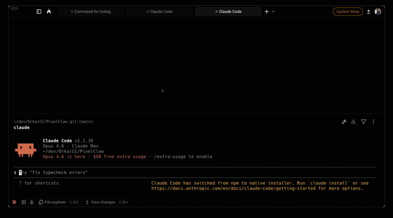

# ClaudeCode-Plugin

**[EN](README.md)** | **[FR](README.fr.md)** | **[DE](README.de.md)**

Plugins listos para usar de Claude Code: memoria, revisión de código, flujo dev, guardias de seguridad. Construidos a partir de meses de uso diario.

> ¿Sigues tus librerías externas, CVEs y más? Descubre [LibTracker](https://app.libtracker.io/).



## Instalación

```bash
/plugin marketplace add joey-barbier/ClaudeCode-Plugin
```

Luego `/plugin` → pestaña **Discover** para explorar, o instala plugins individualmente abajo.

## Catálogo de plugins

| Plugin | Función | Componentes |
|---|---|---|
| **[horka-mentor](#horka-mentor)** | IA pedagogica para devs juniors: evalua, ensena, construye paso a paso, sigue el progreso | 2 skills |
| **[horka-setup](#horka-setup)** | `CLAUDE.md` personalizado + docs de arquitectura + extractor de design system | 3 skills |
| **[horka-memory](#horka-memory)** | Memoria de proyecto persistente entre sesiones, con traspaso por tarea entre desarrolladores | 3 skills + hooks |
| **[horka-review](#horka-review)** | Antagonist + Tech Lead code review | agent + 2 skills + hook |
| **[horka-dev-workflow](#horka-dev-workflow)** | Metodología dev + seguridad git | agent + 2 skills + hook |
| **[horka-analytics](#horka-analytics)** | Experto en tracking / funnels SaaS | agent |
| **[horka-skill-eval](#horka-skill-eval)** | Auditor de calidad de skills | skill |
| **[horka-agent-forge](#horka-agent-forge)** | Factory de skills con quality gates obligatorios | skill |
| **[horka-project-index](#horka-project-index)** | Índice global de proyectos: resuelve comandos genéricos al proyecto/workspace correcto | skill + script |
| **[horka-research-plan](#horka-research-plan)** | El modelo y el esfuerzo adecuados para cada rol de agente → investigación multi-agente que ahorra tokens y termina en un plan de acción con fuentes (página doc-style); variante código para una migración llevada por muchos agentes (testers ciegos antes de los implementadores, rama de integración verde en una puerta, hilos de validación separados); cada ejecución es un grafo de tareas en un tablero en vivo, con el balance de tokens por tarea y por modelo; verificaciones sólidas: el producto ejecutado de punta a punta antes de cada push, pruebas diferenciales viejo/nuevo, veredictos ligados a un commit | skill |
| **[horka-harness-audit](#horka-harness-audit)** | ¿Qué sostiene de verdad tus reglas? Un escaneo que no modifica nada (reglas, tus propios hooks lanzados ante comandos de riesgo que nunca se ejecutan, CI, protección de rama) y un nivel de 0 a 3 en diseño, detección y aplicación, en una página HTML que se abre al final | skill + scripts |
| **[horka-played](#horka-played)** | `/played` como en WoW: tu consumo de tokens de Claude Code por día, máquina y modelo, con tarjeta para compartir y PNG para stories | skill + scripts |

---

## Primeros pasos

### 1. Configurar Claude — `horka-setup`

```bash
claude plugin install horka-setup
```

- `/horka-setup:horka-claude-setup` — cuestionario interactivo → `CLAUDE.md` personalizado
- `/horka-setup:horka-init-docs` — genera docs de arquitectura desde tu código (ARCHITECTURE, CONVENTIONS, WORKFLOW_PATTERNS...)
- `/horka-setup:horka-ds-extractor` — extrae el design system de un proyecto frontend en Markdown (tokens, componentes, layout, guía de estilo)

### 2. Dale memoria a Claude — `horka-memory`

```bash
claude plugin install horka-memory
```

Al iniciar sesión, anuncia la memoria del proyecto y, en una rama base, cuántos commits lleva de retraso respecto al código. `/horka-memory:horka-memory-restore` inicializa un nuevo proyecto — escanea tu codebase y crea los archivos PROJECT_STATE, ARCHITECTURE, DECISIONS, NEXT_STEPS, COMMANDS. En una rama de tarea, `/horka-memory:horka-memory-save` mantiene una ficha de tarea (punto de parada, siguientes pasos, cómo verificar) en `.claude/memory/in-progress/`, para que otro desarrollador retome el trabajo solo con el repositorio. `/horka-memory:horka-memory-close` promueve lo que debe perdurar y elimina la ficha antes de la fusión.

### 3. Elige las herramientas abajo

Cada plugin funciona de forma independiente.

---

## horka-mentor

**IA pedagogica para desarrolladores juniors.** Te acompana mientras codeas en lugar de codear por ti. Requiere el servidor MCP [Context7](https://github.com/upstash/context7).

```bash
claude plugin install horka-mentor
```

| Componente | Activacion | Funcion |
|---|---|---|
| `/horka-mentor:horka-mentor` | "mentor", "mentor learn", "mentor build" | Evalua tu comprension, ensena conceptos, construye paso a paso. Dos modos: learn (Socratico completo) y build (codear juntos — defecto) |
| `/horka-mentor:horka-mentor-quiz` | "mentor quiz", "teste-moi", "revision" | Quiz con repeticion espaciada sobre temas cubiertos (D+1, D+3, D+7, D+14, D+30) |
| Modo proactivo | auto (si activado) | Detecta conceptos fundamentales desconocidos en tus solicitudes — max 2 por sesion, se puede saltar |

**Puntos clave:** seguimiento por tema (unknown/learning/understood/confident), anti-trampas (solo preguntas abiertas), modo directivo para temas de seguridad, traduccion cross-stack para devs aprendiendo un nuevo stack.

---

## horka-review

**Toolkit completo de code review.** Doble pasada: el antagonist encuentra fallos, luego el Tech Lead valida.

```bash
claude plugin install horka-review
```

| Componente | Activacion | Funcion |
|---|---|---|
| `/horka-review:antagonist-reviewer` | "roast", "critique", "find flaws" | Cazador de fallos implacable — cero cumplidos, output BLOCKED/WARNINGS/WASTE |
| `/horka-review:horka-review-changes` | "review changes", "code review" | Revision Tech Lead estructurada en contexto aislado |
| Agente `review-pr` | "review PR" / pre-push | Pasada completa: arquitectura + seguridad + calidad |
| Hook review guard | auto | Bloquea push a rama por defecto (salvo repos listados en `~/.claude/allow-push-default-branch`), impone orden de review en feature branches |

**Orden de review:** Antagonist (encontrar fallos) → Fix → Tech Lead (validar) → Push/PR

---

## horka-dev-workflow

**Metodología dev estructurada + seguridad git.**

```bash
claude plugin install horka-dev-workflow
```

| Componente | Activación | Función |
|---|---|---|
| Agente `dev-methodology` | implementaciones complejas | Coordina cambios multicapa en el orden correcto |
| `/horka-dev-workflow:horka-git-new-feature` | comando | Prepara git: main → pull → elimina mergeadas → nueva rama `feature/` |
| `/horka-dev-workflow:horka-mvp-time-guardian` | comando | Detecta bucles, propone la solución más rápida |
| Hook seguridad git | auto | Bloquea force push, hard reset, checkout ., clean, branch -D |

---

## horka-analytics

**Experto en analytics SaaS.** Se activa automáticamente en temas de tracking / funnels / conversión. Diseña qué medir, implementación y dashboards.

```bash
claude plugin install horka-analytics
```

---

## horka-skill-eval

**Auditor de calidad de skills** contra las best practices oficiales de Anthropic.

```bash
claude plugin install horka-skill-eval
```

| Componente | Activación | Función |
|---|---|---|
| `/horka-skill-eval:horka-skill-evaluate` | comando | Puntúa 5 categorías sobre 100, propone correcciones, re-evalúa antes/después |

---

## horka-research-plan

**El modelo adecuado, el esfuerzo adecuado, en el momento adecuado, en cada nivel.** Cada subtarea va al nivel más barato que la resuelve (el más capaz juzga, el experto investiga o programa, el generalista valida y fusiona, el más barato hace las búsquedas), y cada agente pasa la regla a sus propios subagentes. Dos modos: **investigación**, que termina en un plan de acción con fuentes (una página doc-style, cada cifra con URL y fecha), y **código**, una migración o reescritura llevada por muchos agentes (testers ciegos antes de los implementadores, rama de integración verde en una puerta, hilos de validación separados).

Cada ejecución es un **grafo de tareas en un tablero en vivo**, con el balance de tokens por tarea y por modelo. **[Ver el tablero de ejemplo animado](https://raw.githack.com/joey-barbier/ClaudeCode-Plugin/main/plugins/horka-research-plan/examples/task-graph-demo.html)**. La verificación sigue la práctica del equipo de Claude Code: el producto se ejecuta de punta a punta antes de cada push, las migraciones se comparan viejo contra nuevo, los veredictos quedan ligados a un commit, y tras tres rondas en rojo decide el usuario.

```bash
claude plugin install horka-research-plan
```

| Componente | Disparador | Hace |
|---|---|---|
| `/horka-research-plan:horka-research-plan` | "full check and a plan", "plan con fuentes", "migra X a Y con muchos agentes", "qué modelo para qué tarea" | Dimensiona la ejecución (carril corto o completo), escribe el grafo de tareas, lanza según el grafo con enrutamiento de modelo, valida con terceros, entrega la página o la rama verde, y una retrospectiva reescribe un archivo de lecciones que lee la siguiente ejecución |

**Tres reglas:** ninguna cifra ni comportamiento de memoria · ningún agente califica su propio trabajo · nada se crea ni se programa sin el visto bueno del usuario. Detalles: [README del plugin](plugins/horka-research-plan/README.md).

---

## horka-played

**`/played` para Claude Code, como en World of Warcraft**: cuántos tokens has quemado. Lee tus transcripts locales (30 días por defecto), fusiona tus otras máquinas y abre una página doc-style.

```bash
claude plugin install horka-played
```

| Componente | Disparador | Hace |
|---|---|---|
| `/horka-played:played` | "/played", "how many tokens did I use", "cuántos tokens he usado" | Totales, por día / máquina / modelo, parte de los subagentes, día récord, selector de periodo (último día, 7 días, rango libre, −1/+1 día), tarjeta para compartir y PNG para stories 1080×1920 |

Solo lectura, ninguna cifra estimada. Varias máquinas: ejecútalo en cada una y copia `~/.claude/played/<label>.json` a la máquina donde abres la página. Las sesiones en la nube guardan su consumo al final de cada turno (hilos de proyecto de claude.ai, hook del plugin) y se cuentan desde la instalación.

---

## horka-harness-audit

**¿Qué sostiene de verdad tus reglas?** Una auditoría de tu forma de desarrollar con agentes de IA: para cada regla y cada control, si lo sostiene una frase, un script, un hook, la CI o la plataforma.

```bash
claude plugin install horka-harness-audit
```

| Componente | Disparador | Función |
|---|---|---|
| `/horka-harness-audit:horka-harness-audit` | "audit my harness", "do my guardrails hold", "audita mi harness", "¿qué nivel tengo?" | Dos o tres preguntas, un escaneo de unos 30 segundos que no modifica nada y una página HTML que se abre al final: un nivel de 0 a 3 en tres ejes (diseño, detección, aplicación), lo que aguanta, lo que no, y las acciones por hacer, de la más barata a la más cara |

El escaneo prueba tus reglas de permisos y lanza tus propios hooks PreToolUse ante una serie de comandos de riesgo (los comandos nunca se ejecutan, pero un hook que escribe un registro los registrará; los hooks definidos por un repositorio escaneado no se lanzan), lee las dependencias de la CI y, mediante `gh`, la protección de rama y las fusiones en rojo. Detalles: [README del plugin](plugins/horka-harness-audit/README.md).

---

## Cómo funcionan los plugins

| Tipo | Comportamiento | Ejemplo |
|---|---|---|
| **Agents** | Autónomos — Claude los activa cuando es relevante | `review-pr` en "review PR" |
| **Skills** | Comandos que escribes | `/horka-memory:horka-memory-restore` |
| **Hooks** | Guardias silenciosos en segundo plano | Bloquea `git push --force` |

## ¿Preguntas?

Hago stream en vivo en Twitch mientras construyo con Claude Code. Ven a hacer preguntas, ver los plugins en acción o sugerir nuevos.

**[twitch.tv/horka_tv](https://twitch.tv/horka_tv)**

## Licencia

MIT — libre de usar, modificar y compartir.
