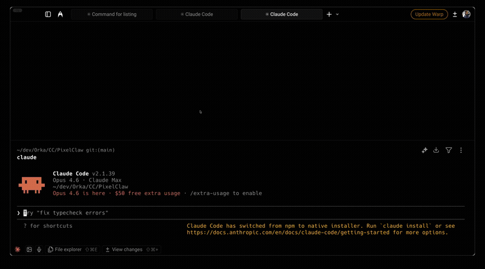

# ClaudeCode-Plugin

**[EN](README.md)** | **[ES](README.es.md)** | **[DE](README.de.md)**

Plugins Claude Code prêts à l'emploi : mémoire, revue de code, workflow dev, garde-fous. Construits à partir de mois d'utilisation quotidienne.

> Tu suis tes librairies externes, CVEs et plus ? Découvre [LibTracker](https://app.libtracker.io/).



## Installation

```bash
/plugin marketplace add joey-barbier/ClaudeCode-Plugin
```

Puis `/plugin` → onglet **Discover** pour parcourir, ou installe les plugins individuellement ci-dessous.

## Catalogue des plugins

| Plugin | Rôle | Composants |
|---|---|---|
| **[horka-mentor](#horka-mentor)** | IA pedagogique pour devs juniors : evalue, enseigne, code pas-a-pas, suit la progression | 2 skills |
| **[horka-setup](#horka-setup)** | `CLAUDE.md` personnalisé + docs d'architecture + extracteur design system | 3 skills |
| **[horka-memory](#horka-memory)** | Mémoire projet persistante entre sessions | 1 skill |
| **[horka-review](#horka-review)** | Antagonist + Tech Lead code review | agent + 2 skills + hook |
| **[horka-dev-workflow](#horka-dev-workflow)** | Méthodologie dev + sécurité git | agent + 2 skills + hook |
| **[horka-analytics](#horka-analytics)** | Expert tracking / funnels SaaS | agent |
| **[horka-skill-eval](#horka-skill-eval)** | Auditeur qualité de skills | skill |
| **[horka-agent-forge](#horka-agent-forge)** | Usine à skills avec gates de qualité obligatoires | skill |
| **[horka-project-index](#horka-project-index)** | Index global des projets : résout les commandes génériques vers le bon projet/workspace | skill + script |
| **[horka-research-plan](#horka-research-plan)** | Le bon modèle et le bon effort pour chaque rôle d'agent → recherche multi-agents économe en tokens, qui aboutit à un plan d'actions sourcé (page doc-style) ; variante code pour une migration menée par de nombreux agents (testeurs à l'aveugle avant les implémenteurs, branche d'intégration verte sur une porte, fils de validation séparés) | skill |
| **[horka-played](#horka-played)** | `/played` comme dans WoW : ta conso de tokens Claude Code par jour, machine et modèle, avec carte à partager et PNG story | skill + scripts |

---

## Commencer

### 1. Configurer Claude — `horka-setup`

```bash
claude plugin install horka-setup
```

- `/horka-setup:horka-claude-setup` — questionnaire interactif → `CLAUDE.md` personnalisé
- `/horka-setup:horka-init-docs` — génère les docs d'architecture depuis ton code (ARCHITECTURE, CONVENTIONS, WORKFLOW_PATTERNS...)
- `/horka-setup:horka-ds-extractor` — extrait le design system d'un projet frontend en Markdown (tokens, composants, layout, guide de style)

### 2. Donner une mémoire à Claude — `horka-memory`

```bash
claude plugin install horka-memory
```

Restaure automatiquement le contexte projet au début de session. `/horka-memory:horka-memory-restore` pour initialiser sur un nouveau projet — scanne ta codebase et crée les fichiers PROJECT_STATE, ARCHITECTURE, DECISIONS, NEXT_STEPS, COMMANDS.

### 3. Choisis les outils ci-dessous

Chaque plugin fonctionne indépendamment.

---

## horka-mentor

**IA pedagogique pour developpeurs juniors.** T'accompagne pendant que tu codes au lieu de coder a ta place. Necessite le serveur MCP [Context7](https://github.com/upstash/context7).

```bash
claude plugin install horka-mentor
```

| Composant | Declenchement | Role |
|---|---|---|
| `/horka-mentor:horka-mentor` | "mentor", "mentor learn", "mentor build" | Evalue ta comprehension, enseigne les concepts, code pas-a-pas. Deux modes : learn (Socratique complet) et build (code ensemble — defaut) |
| `/horka-mentor:horka-mentor-quiz` | "mentor quiz", "teste-moi", "revision" | Quiz a repetition espacee sur les sujets couverts (J+1, J+3, J+7, J+14, J+30) |
| Mode proactif | auto (si active) | Detecte les concepts fondamentaux inconnus dans tes demandes — max 2 par session, skippable |

**Points cles :** suivi par topic (unknown/learning/understood/confident), anti-gaming (questions ouvertes uniquement), mode directif pour les sujets securite, traduction cross-stack pour les devs qui apprennent un nouveau stack.

---

## horka-review

**Toolkit complet de code review.** Double passe : l'antagonist trouve les failles, puis le Tech Lead valide.

```bash
claude plugin install horka-review
```

| Composant | Déclenchement | Rôle |
|---|---|---|
| `/horka-review:antagonist-reviewer` | "roast", "critique", "find flaws" | Chasseur de failles impitoyable — zero compliment, output BLOCKED/WARNINGS/WASTE |
| `/horka-review:horka-review-changes` | "review changes", "code review" | Revue Tech Lead structuree dans un contexte isole |
| Agent `review-pr` | "review PR" / pre-push | Passe complete architecture + securite + qualite |
| Hook review guard | auto | Bloque push vers branche par defaut (sauf dépôts listés dans `~/.claude/allow-push-default-branch`), impose l'ordre de review sur feature branches |

**Ordre de review :** Antagonist (trouver les failles) → Fix → Tech Lead (valider) → Push/PR

---

## horka-dev-workflow

**Méthodologie dev structurée + sécurité git.**

```bash
claude plugin install horka-dev-workflow
```

| Composant | Déclenchement | Rôle |
|---|---|---|
| Agent `dev-methodology` | implémentations complexes | Coordonne les changements multicouches dans le bon ordre |
| `/horka-dev-workflow:horka-git-new-feature` | commande | Prépare git : main → pull → supprime mergées → nouvelle branche `feature/` |
| `/horka-dev-workflow:horka-mvp-time-guardian` | commande | Détecte les boucles, propose la solution la plus rapide |
| Hook sécurité git | auto | Bloque force push, hard reset, checkout ., clean, branch -D |

---

## horka-analytics

**Expert analytics SaaS.** S'active automatiquement sur les sujets tracking / funnels / conversion. Conçoit quoi mesurer, l'implémentation et les dashboards.

```bash
claude plugin install horka-analytics
```

---

## horka-skill-eval

**Auditeur qualité de skills** contre les best practices Anthropic.

```bash
claude plugin install horka-skill-eval
```

| Composant | Déclenchement | Rôle |
|---|---|---|
| `/horka-skill-eval:horka-skill-evaluate` | commande | Note 5 catégories sur 100, propose des corrections, ré-évalue avant/après |

---

## horka-research-plan

**Le bon modèle, le bon effort, au bon moment.** Par défaut, chaque sous-agent hérite du modèle de la session ; ce skill en attribue un par rôle : le modèle le plus capable pour l'orchestration, la critique et les personas, le niveau expert pour les chercheurs, le niveau généraliste pour les validateurs et les comptages, chacun avec son propre niveau d'effort. Le jugement reste sur le meilleur modèle, le travail mécanique passe sur des modèles moins chers, et le coût réel de chaque vague est noté dans le bilan du run.

Ce que ça livre : **recherche multi-agents qui finit en plan d'actions sourcé**, livré en une page HTML doc-style. Pour les demandes « un check complet et un plan » : go-to-market, quel canal, comment se faire découvrir, comment répondre à une réglementation.

```bash
claude plugin install horka-research-plan
```

| Composant | Déclencheur | Rôle |
|---|---|---|
| `/horka-research-plan:horka-research-plan` | « check complet et un plan », « plan sourcé », « comment se faire découvrir », « go-to-market » | État réel en trois états (prod / develop / PR ouvertes), puis vagues courtes : personas + demande réelle d'abord, chercheurs par type d'action, dédoublonnage par code, validateurs qui ouvrent chaque URL, critique antagoniste, faisabilité + complétude, une page HTML, puis une rétrospective par un agent séparé qui réécrit un fichier de leçons relu au run suivant |

**Trois règles :** aucun chiffre de mémoire (URL, date, chip de statut sur chaque nombre) · aucun agent ne note son propre travail · rien n'est créé ni planifié (besoins produit et tâches dans un onglet « à transmettre »). Fournit les briefs par rôle, les schémas JSON, les squelettes `Workflow`, la structure de page et la méthode de rétrospective (scorecard, fichier de leçons, une expérience par run) dans `references/`. Modèle et effort par rôle : modèle le plus capable pour orchestration / critique / personas, expert pour les chercheurs, généraliste pour les validateurs.

---

## horka-played

**`/played` pour Claude Code, comme dans World of Warcraft** : combien de tokens tu as brûlés. Lit tes transcripts locaux (30 jours par défaut), fusionne tes autres machines et ouvre une page doc-style.

```bash
claude plugin install horka-played
```

| Composant | Déclencheur | Rôle |
|---|---|---|
| `/horka-played:played` | « /played », « combien de tokens j'ai consommé », « ma conso Claude Code » | Totaux, par jour / machine / modèle, part des sous-agents, jour record, choix de période (dernier jour, 7 jours, plage libre, −1/+1 jour), carte à partager et PNG story 1080×1920 |

Lecture seule, aucun chiffre estimé. Plusieurs machines : lance-le sur chacune et copie `~/.claude/played/<label>.json` sur la machine où tu ouvres la page. Les sessions cloud ne sont pas mesurables, et la page le dit.

---

## Fonctionnement des plugins

| Type | Comportement | Exemple |
|---|---|---|
| **Agents** | Autonomes — Claude les active quand pertinent | `review-pr` sur "review PR" |
| **Skills** | Commandes que tu tapes | `/horka-memory:horka-memory-restore` |
| **Hooks** | Garde-fous silencieux en arrière-plan | Bloque `git push --force` |

## Questions ?

Je stream en direct sur Twitch pendant que je code avec Claude Code. Viens poser des questions, voir les plugins en action, ou en suggérer de nouveaux.

**[twitch.tv/horka_tv](https://twitch.tv/horka_tv)**

## Licence

MIT — libre d'utilisation, de modification et de partage.
